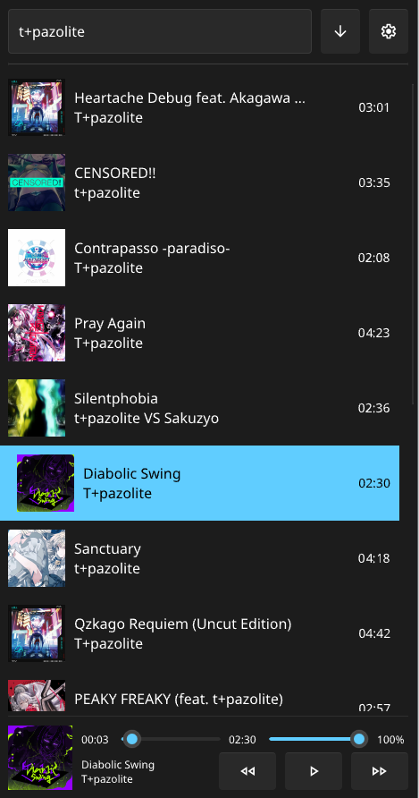

# N Music

Cross-platform music player written in Rust + Slint



## Features

- Cover art
- Music from local folders, web playlists and Telegram chats
- Supports media control on all platforms (Windows, Mac, Linux and Android)
- A native Mac app (SwiftUI and AppKit, Apple silicon) that plays through Core Audio at each
  track's own sample rate
- Extremely fast and resource efficient
- Locale support

## Coming

- Streaming:
    - [ ] Simple web streaming
    - [ ] Youtube streaming
    - [ ] Deezer streaming

- QoL:
    - [ ] Playlists
    - [ ] Auto updater (desktop only; opt-out)

## Platforms

- **Linux and Windows**: the Qt desktop app (`n_music_desktop`). Releases have it for these
  two; it still builds from source on a Mac, but is not released for macOS.
- **macOS**: the native app, `n_music_macos`, over the same core. Releases have it as
  `N-Music-<version>-macos-arm64.dmg` and as a `.zip`. See
  [n_music_macos/README.md](n_music_macos/README.md) for what is Mac-specific, building it,
  and opening the ad-hoc signed app the first time.
- **Android**: `n_music_android`; releases have its APK.

## Contribute

### Building

Run in debug mode:

```shell
cargo run --package n_music_desktop
```

Build in release mode:

```shell
cargo build --release --package n_music_desktop
```

The macOS app builds with Xcode: see [n_music_macos/README.md](n_music_macos/README.md#building).

### Telegram

Signing in to Telegram needs N Music's API credentials when building. Register an app at
[my.telegram.org](https://my.telegram.org) and pass its id and hash:

```shell
N_MUSIC_TELEGRAM_API_ID=12345 N_MUSIC_TELEGRAM_API_HASH=0123456789abcdef \
  cargo run --package n_music_desktop
```

The Android app takes them the same way, when building its native library with
`n_music_android/compile_rust.sh`. Without them, the app builds and runs as before, with the
Telegram source turned off. Release builds take them from the `N_MUSIC_TELEGRAM_API_ID` and
`N_MUSIC_TELEGRAM_API_HASH` secrets.

### Translations

If your language isn't fully supported by N Music, you can add a language by creating a file in
`n_music_desktop/assets/lang`.
The file must be a JSON file and its name should be like this: `it_Italiano.json`; `it` is the denominator of the
language, `Italiano` is the name of the language in that language (i.e. how it should be displayed in the app).

You can copy the english file and rename it correctly and start translating, then to check if everything works correctly
you can compile and run a debug build, the language will automatically be added to the supported languages during
compilation.

The Android app keeps its strings as Android resources in
`n_music_android/android/src/main/res/values/strings.xml`. A translation of them goes in a
`values-<language>` folder next to it, like `values-it` for Italian.
